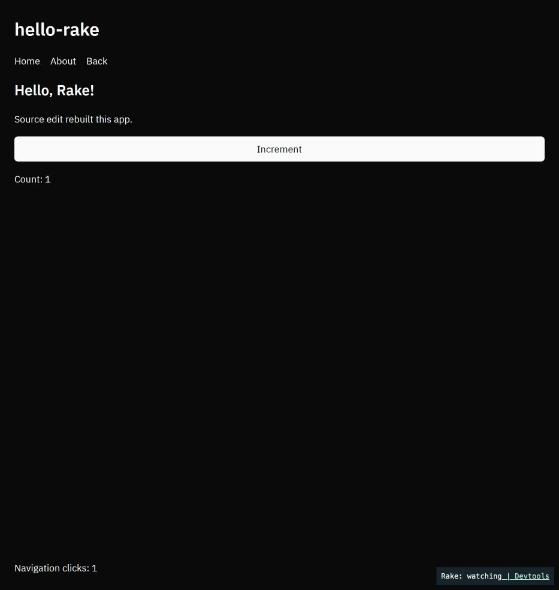

# Core view syntax and project scaffolding

Verdict: implemented and runtime-tested in the isolated worktree. Final required
checks pass except six pre-existing spacing warnings in unchanged native-accessibility
code. The default Git-pinned scaffold builds for both targets; native watched reload,
browser navigation and command invocation were exercised. Mean clean native release
wall time increased 28.7%, child CPU time 37.1%, and executable size 4.64%. The stable
Web build passes; optimized `rake-view` Wasm grew by 392 bytes. No requested stop
condition was triggered: measured wall-time overhead is close to the earlier 28%
estimate, with substantial run-to-run variance. Base adds a real default build cost.

## Checkout and commits

- Base: `origin/main` at `f0279af82bbdb5f0117b1694b4767f10c0909652`.
- Branch: `codex/view-core-rake-new`.
- Worktree: `/private/tmp/rake-view-core`.
- The main checkout's working files were not edited, stashed, reset, cleaned or switched.
- No push, merge, tag, release or PR was performed.

Code commits:

- `8da31c8 feat(view): include UI with default GPUI`
- `4042cb6 feat(cli): scaffold routed desktop and web apps`
- `3c22549 docs: start new apps with rake new and view`
- `2da07fd fix(cli): hide templates from Cargo discovery`
- `f382d72 ci: consolidate views without DevTools`
- `4ab7cfa fix(cli): refresh revisions in cached installs`
- `bfb0417 style: apply task spacing conventions`

## Feature and migration changes

The default `gpui` feature enables Base-backed view controls, `view!`, themes,
style presets and overlays. GPUI-only hosts always initialize Base and use its
Root. Redundant UI branches inside GPUI modules were removed. The macro crate's
`view` feature is enabled through `gpui`; it remains off in headless builds.

`experimental-view` is an empty, deprecated compatibility alias. Default apps
can remove it. Apps that used `default-features = false` plus that alias must
replace it with `features = ["gpui"]` to keep their UI. `view-test-support`
enables `gpui` directly. `kit` remains a separate native-only opt-in; DevTools
instrumentation remains behind `devtools` and compiles out otherwise.

The view and overlay guides were renamed and all source/doc links updated.
The utility-vocabulary markers remain in the view guide. Rake remains a source
alpha with migration notes, without a stability or platform-status upgrade.
Overlay styling and menu roles are still evolving, separately from core view syntax.

## Scaffolding

One embedded template, with a retained counter page, an About page, a persistent
window layout, a semantic theme and a registered `app.greet` command. Control
uses `ControlConfig::FromEnvironment`. No minimal variant was added.

Creation makes no network calls and runs no Cargo build. It accepts absent or
empty destinations, rejects symlink/non-empty destinations, validates portable
Cargo names and rejects traversal. It creates files exclusively and rolls back
only created files and empty created directories. Git is opt-in, staged on the
same filesystem, and never committed. Local path strings are escaped and expanded
once, including paths containing quotes or template-like text.

The CLI captures its checkout SHA at build time. A watch outside Cargo's immutable
Git sources refreshes metadata across cached installs; missing Git metadata clears
any inherited revision rather than accidentally pinning a parent build's SHA.
A fast real-Git/Cargo regression test installs two revisions into one target cache
and also builds unpacked sources with deliberately inherited metadata. It failed
before the fixes and passes afterward.
Missing revisions fail with an explicit `--rake-rev REV` instruction; an explicit
pin must be a full SHA. `--rake-path` points to `crates/rake` in a checkout.
Generated apps carry Rake's parser stack-guard patch, since Cargo does not inherit
root patches from dependencies. The first dev/build creates the lockfile; existing
locks remain enforced. The embedded manifest uses a `.template` suffix so Cargo's
Git-package scanner does not parse placeholders as an actual package.

Generated file tree:

```text
my-app/
├── .gitignore
├── Cargo.toml
├── README.md
├── rust-toolchain.toml
├── src/
│   ├── lib.rs
│   └── main.rs
└── web/
    └── index.html
```

`--git` additionally creates `.git/`; the first build creates `Cargo.lock`.
The application ID uses a valid dot-separated identifier with hyphens; the
README identifies both locations to change it.

## Final README quick start

Rake needs Rust 1.98.0, native development tools and Python 3.11+. Install the CLI
and create a desktop/browser app:

```sh
cargo install --git https://github.com/1bye/rake --locked rake-cli
rake new hello-rake
cd hello-rake
rake dev
```

The generated app has two pages, a persistent layout, a theme and an agent-callable
command. For the browser, use `rake dev --target web` with a WebGPU-capable browser
and the matching `wasm-bindgen-cli` (the builder prints the install command).
The first dev run creates `Cargo.lock`; commit it. `rake new` pins Rake to the
exact revision the CLI was built from.

UI uses `view!`. A complete Hello window looks like this:

```rust
use rake::gpui::{Context, Window, prelude::*};
use rake::prelude::*;

struct Hello;

impl Render for Hello {
    fn render(&mut self, _: &mut Window, _: &mut Context<Self>) -> impl IntoElement {
        rake::view! { <main class="size-full p-6"><h1>"Hello, Rake!"</h1></main> }
    }
}

#[rake::app]
fn app() -> App {
    App::new("com.example.hello-rake")
        .root(|_, _, cx| cx.new(|_| Hello).into())
}
```

To add Rake to an existing crate, copy the pinned dependency and parser patch from
a generated `Cargo.toml`, then use the Hello entry above. `view!`, themes and style
presets are included by default; Kit and DevTools remain optional.

[Getting started](../../docs/getting-started.md) covers browser prerequisites, local
Rake development and agents. On macOS, check that `which rake` selects Cargo's CLI
rather than the system Ruby tool.

## Cost measurements

Final interleaved native measurements, in order before 1, after 1, before 2,
after 2. All four builds succeeded, with four Cargo jobs and a fresh target for
each run. All of this task's verification/runtime builds had finished first.

| Metric | Before | After | Change |
| --- | ---: | ---: | ---: |
| Clean release wall time, run 1 | 221.08 s | 207.45 s | -6.2% |
| Clean release wall time, run 2 | 148.22 s | 267.99 s | +80.8% |
| Mean wall time | 184.65 s | 237.72 s | +28.74% |
| Child CPU time, run 1 | 595.47 s | 705.22 s | +18.4% |
| Child CPU time, run 2 | 515.62 s | 817.71 s | +58.6% |
| Mean child CPU time | 555.545 s | 761.465 s | +37.07% |
| Hello release executable, bytes (identical across runs) | 17,661,056 | 18,480,752 | +819,696 (+4.64%) |
| `rake-view` raw release Wasm, bytes | 21,734,343 | 21,734,213 | -130 bytes |
| Wasm after wasm-bindgen 0.2.129, bytes | 19,501,873 | 19,502,265 | +392 bytes (+0.0020%) |

These are two samples per phase, not a precise performance guarantee. The host
was shared, caches outside Cargo targets remained warm, and free disk space was
low near the end. Wall-time variance is large even within the same phase; CPU
time (user plus system time of build subprocesses) is reported as additional
evidence rather than hiding that variance. Mean wall-time overhead is close to
the earlier 28% estimate; CPU overhead is higher. This supports keeping Base on
by default for this task, without claiming the extra cost is negligible.

Earlier measurements ran concurrently with this task's compiler workloads and
were superseded for timing conclusions: before wall times 120.09/276.34 seconds,
after 513.10/505.18 seconds. Their executable sizes matched the final runs.
The release Wasm builds took 581.04/529.47 seconds respectively, also under that
contention; those wall times are not an estimate of Wasm compile-time overhead.
Shared existing dependency versions were retained; the after graph adds 22
package names and additional versions needed by Base's target-specific graph.

The same GPUI-builder Hello source is used on both sides to isolate the feature
cost. Targets are fresh for each release build, with downloaded crates cached.
The before tree is an archive of the base commit. The after tree has the core
feature changes. Release Wasm is built for `rake-view`, then processed with the
matching wasm-bindgen CLI, matching the optimized path in `rake bundle`. The
current bundler does not invoke wasm-opt; no extra optimizer is substituted.
`rake-view` already used Base before this change, unlike a default Hello app.
Its almost-flat result measures this promotion, not the earlier introduction of
Base or a bare Hello app's Wasm payload.

Measurement scripts and raw results are retained at
`/private/tmp/rake-view-core-measure.py`,
`/private/tmp/rake-view-core-measurements/{before,after}.json`,
`/private/tmp/rake-view-core-controlled-cost.py` and
`/private/tmp/rake-view-core-controlled-cost/results.json`. The large task-owned
workspace target cache was removed after all checks and measurements; source,
logs, installed CLI and runtime evidence remain.

## Runtime observations

- Local-path creation: `rake new hello-rake --rake-path /private/tmp/rake-view-core/crates/rake --json`, followed by `rake dev --no-open` with Python 3.14 on PATH.
- The macOS window opened. CUA input incremented Count to 1, navigated to About,
  then Back restored Count 1. The layout retained Navigation clicks 1.
- Through `/tmp/rake-dev-219ybogh/control`, `rake ctl commands list --json`
  exposed `app.greet`, required string argument `name`, Headless capability and
  string result schema. Running it with `{"name":"Rake"}` committed and returned
  `Hello, Rake!` through the real control transport.
- The first source edit compiled, but its native reload handoff reported
  `reload_blocked` / `timed out`. The old window/control endpoint then stopped
  responding to the probes. A stack sample showed the main thread idle in the
  AppKit event loop; this does not establish a root cause. The first session was
  stopped. The next retry was interrupted with the chat and is not counted as a
  successful reload.
- Final installed-Git case: `rake dev --no-open` in
  `/private/tmp/rake-view-core-outside-proof/clean/hello-rake`. A real source edit
  changed the Home text, compiled in 5.17 seconds, and completed `preparing_reload`
  followed by a restart. The supervisor published build 2 with no error; the
  native runtime PID changed from 73878 to 74333. Thus one complete watched reload
  passed after the earlier failed attempt; the initial timeout remains a follow-up.
- `app_running` is earlier than control readiness. An immediate final-Git control
  query returned no matching instance. A separate readiness-aware session found
  the command on attempt 5, then invoking it returned `Hello, Rake!` with operation
  state `Committed`. No source/API change was made to hide the readiness interval.
- Web: `rake dev --target web --port 0 --no-open` served the local-path scaffold at
  `http://127.0.0.1:62227/`. The Codex in-app Chromium browser rendered the real GPUI
  WebGPU canvas. Browser input incremented Count, opened About, then Back restored
  Count 1 while Navigation clicks remained 1. Source edits had rebuilt the Web app.
  Canvas input used the browser's documented CDP capability after the higher-level
  canvas click failed; this was real browser input, without DOM or model mutation.
- Fresh standalone resolution chose wasm-bindgen 0.2.130, versus this repository's
  0.2.129 lock. The builder printed the correct installation prerequisite; 0.2.130
  was installed in `/private/tmp/rake-view-core-web-tools`, without replacing user
  executables. The repository's builds used the matching 0.2.129 tool.
- The README Hello Rust block was extracted verbatim, built and launched natively.
  All eight commands in the existing examples table were also built and launched;
  each remained alive during a three-second observation and was then stopped.
  Fieldnotes used an isolated `RAKE_NOTES_DATA_DIR`. These are launch checks,
  separate from the generated app's navigation/counter interaction checks.



## Outside-user path and exact revisions

The actual README installation command was run:

```sh
cargo install --git https://github.com/1bye/rake --locked rake-cli
```

Its environment used a temporary `CARGO_INSTALL_ROOT`, a task-owned target directory,
and a **process-scoped** Git `insteadOf` mapping from the HTTPS URL to
`file:///private/tmp/rake-view-core`. No global Git configuration was changed.
The final CLI was installed at `/private/tmp/rake-view-core-installed-clean/bin/rake`
from commit `bfb04172fc596d1423d4ea0d9ca2f6f1ff1ff22a`.

A preliminary shared cache had been populated by the earlier, incorrect build
script and retained its old SHA. Only that prototype CLI's build/fingerprint
cache was cleared before the final installation. The corrected build script's
own repeated-install regression passes; the fresh final binary was checked rather
than trusting the install log's version label.

From a directory outside the worktree, `rake new hello-rake` ran with no path or
revision override. Its dependency **and parser patch** both contained the exact
full SHA above. Creation also passed with an empty PATH, proving no Cargo/Git
subprocess is needed for default scaffolding. The explicit override stand-in was:

```sh
rake new explicit-confirmed --rake-rev bfb04172fc596d1423d4ea0d9ca2f6f1ff1ff22a --json
```

For the default scaffold, dependency resolution then ran from the local Git cache,
followed by `cargo build --locked` and `rake build --target web --json`, both
successful. The Web artifact was
`/private/tmp/rake-view-core-outside-proof/clean/hello-rake/dist/hello-rake/web`.
The same default Git-pinned app supplied the final native reload and command tests
above. No `--rake-path` was used for these builds or runs.

## Verification results

All Python checks used Homebrew Python 3.14, not the system Python 3.9. OpenSSL
remote/release tests used Homebrew OpenSSL 3 rather than LibreSSL. Rust was 1.98.0;
spacing used the project's pinned nightly-2026-08-20 Dylint toolchain. Cargo checks
used cached dependencies/offline resolution, except installing the matching
wasm-bindgen tool and the process-local Git-install stand-in.

Final required checks were rerun after the revision-capture and spacing fixes:

| Command | Result |
| --- | --- |
| `python3 scripts/check-gpui-pins.py` | PASS |
| `cargo fmt --all --check` | PASS |
| `cargo check --workspace --all-targets --locked` | PASS |
| `cargo clippy --workspace --all-targets --locked -- -D warnings` | PASS |
| `cargo test --workspace --locked --no-fail-fast` | PASS |
| `cargo test -p rake --features view-test-support,devtools --lib --test view_state --test element_inspection --locked` | PASS |
| `cargo check -p rake --no-default-features --locked` | PASS |
| `cargo clippy -p rake --no-default-features --locked -- -D warnings` | PASS |
| `cargo check -p rake --lib --target wasm32-unknown-unknown --locked` | PASS |
| `cargo test -p rake-native --features native-tests --test appkit --locked` | PASS |
| `cargo doc --workspace --no-deps --locked` | PASS |
| `python3 scripts/check-spacing.py` | FAIL: six unchanged spacing locations |

The remaining spacing locations are present byte-for-byte in the base commit;
`git diff f0279af --` for both files is empty. Per the task's scope, they were
reported rather than editing unrelated native-accessibility code:

- `crates/rake-native/src/macos/accessibility.rs`: lines 118 and 135.
- `crates/rake-native/src/macos/accessibility/hit_test.rs`: lines 27, 29, 73 and 133.

No spacing warnings remain in files changed by this task. Duplicate library/test
compilations emit the same six locations more than once.

The rest of the current CI run steps were executed as well. The interruption
stopped the first runner during the scaffold consumer test; completed results
were retained, and unfinished commands were resumed. The completed consumer run
took 41.10 seconds with dependency caches populated. The earlier entirely fresh
consumer build also passed for native and Wasm (584.32 seconds).

| Additional CI command | Result |
| --- | --- |
| `cargo clippy -p rake --features native-components --all-targets --locked -- -D warnings` | PASS |
| `cargo clippy -p rake-native --features native-tests --all-targets --locked -- -D warnings` | PASS |
| `cargo test -p rake-native --doc --locked` | PASS |
| `cargo clippy -p rake-client -p rake-http -p rake-protocol -p rake-diagnostics --lib --locked -- -D warnings -D clippy::missing_errors_doc -D clippy::must_use_candidate -D clippy::return_self_not_must_use` | PASS |
| `cargo clippy -p rake --all-targets --features view-test-support,devtools --locked -- -D warnings` | PASS |
| `cargo test -p rake-ui --features kit --test semantic --locked` | PASS |
| `cargo test -p rake --features kit,view-test-support,devtools --lib --test view_state --locked` | PASS |
| `cargo clippy -p rake-kit-example --features kit,devtools --all-targets --locked -- -D warnings` | PASS |
| `cargo check -p renamed-facade --features devtools --locked` | PASS |
| `cargo test -p rake-view --features view-test-support --lib --locked` | PASS |
| `cargo check -p rake --features native-components --lib --target wasm32-unknown-unknown --locked` | PASS |
| `cargo check -p rake-diagnostics -p rake-protocol -p rake-http --lib --target wasm32-unknown-unknown --locked` | PASS |
| `cargo check -p rake-macros --no-default-features --locked` | PASS |
| `cargo test -p rake-client -p rake-http -p rake-protocol --locked` | PASS |
| `cargo test -p rake-ui --features test-support --lib --locked` | PASS |
| `cargo test -p rake --features view-test-support --lib --test view_state --test actions --test inspection_compiled_out --locked` | PASS |
| `cargo test -p rake-cli --features scaffold-tests --test new_build --locked` | PASS |
| `cargo build -p rake-cli --locked` | PASS |
| `python3 scripts/test-bundle.py` | PASS |
| `python3 scripts/test-dev-bridge.py` | PASS |
| `python3 scripts/test-supervisor.py` | PASS |
| `python3 scripts/test-inspector.py` | PASS |
| `node scripts/test-web-loading.mjs` | PASS |
| `node scripts/test-inspector.mjs` | PASS |
| `node scripts/test-inspector-ui.mjs` | PASS |
| `node scripts/test-notes-storage.mjs` | PASS |
| `node scripts/test-platform.mjs` | PASS |
| `node scripts/test-web-runtime.mjs` | PASS |
| `node scripts/test-offline.mjs` | PASS |
| `node scripts/test-file-processing.mjs` | PASS |
| `cargo test -p rake-files --lib --locked` | PASS |
| `cargo clippy -p rake-files --lib --target wasm32-unknown-unknown --locked -- -D warnings` | PASS |
| `python3 scripts/test-web-deployment.py` | PASS |
| `cargo test -p rake --no-default-features --test platform --locked` | PASS |
| `cargo test -p rake --test platform --locked` | PASS |
| `cargo clippy -p rake-web-host-fixture --lib --target wasm32-unknown-unknown --locked -- -D warnings` | PASS |
| `cargo clippy -p rake --no-default-features --target wasm32-unknown-unknown --locked -- -D warnings` | PASS |
| `cargo test -p rake-inspector --no-default-features --locked` | PASS |
| `cargo clippy -p rake-inspector --no-default-features --all-targets --locked -- -D warnings` | PASS |
| `cargo test -p rake-notes --no-default-features --locked` | PASS |
| `cargo clippy -p rake-notes --no-default-features --all-targets --locked -- -D warnings` | PASS |
| `cargo test -p rake --no-default-features --test managed_work --test routing --test windows --test runtime_control --test reload --test web_deployment --test element_inspection --test application_commands --test guarded_quit --test services --locked` | PASS |
| `cargo check -p rake-foundation -p rake-routing -p rake-view -p rake-inspector -p renamed-facade --lib --target wasm32-unknown-unknown --locked` | PASS |
| `cargo check -p rake-view -p renamed-facade --lib --features rake/devtools --target wasm32-unknown-unknown --locked` | PASS |
| `cargo clippy -p rake -p rake-foundation -p rake-routing -p rake-notes -p rake-view -p rake-inspector -p renamed-facade --lib --target wasm32-unknown-unknown --locked -- -D warnings` | PASS |
| `cargo build -p rake-foundation -p rake-routing -p rake-notes -p rake-view -p rake-inspector --lib --target wasm32-unknown-unknown --locked` | PASS |
| `cargo check -p rake-routing --lib --features hash-routing --target wasm32-unknown-unknown --locked` | PASS |

Supplementary checks:

- `cargo test -p rake-cli --test build_revision --test new --locked`: PASS,
  including the real cached-Git/unpacked-source regression and seven CLI tests.
- `cargo test -p rake --test inspection_compiled_out --locked`: PASS (2 tests).
- `cargo check -p rake --no-default-features --features experimental-view --locked`:
  PASS; the deprecated alias does not turn UI back on.
- A real Cargo metadata probe verified that `--no-deps` creates no first lockfile,
  leaves an existing lock unchanged, and the subsequent `--locked` resolution
  rejects a stale manifest/lock pair.
- All local README/docs/example links and Markdown heading anchors resolve.
  Both renamed documentation filenames are absent outside `.agents/`; the old
  feature name remains only in the alias declaration and its migration guide.
- `cdp::evaluate::tests::lost_submission_and_pending_observation_never_resend_commands`
  passed in both complete workspace test runs: 0 failures in 2 executions. No
  failure-triggered flake investigation or unrelated CDP change was needed.
- `git diff --check`: PASS.

Skipped CI setup actions: reinstalling Rust/Clippy/rustfmt, Node, the already
installed matching repository wasm-bindgen 0.2.129 CLI, and the pinned
nightly/Dylint tools. Their actual check commands ran. No CI trigger was changed.

## What needs a push

The commit pinned by a newly built CLI must be reachable at the Rake Git URL.
No commit was pushed. The outside-user test uses a process-scoped Git URL rewrite
to this local Git checkout; it cannot prove GitHub availability. Real HTTPS clone,
installation and fresh app dependency resolution without that rewrite must be
repeated after the tested revision is pushed.

## Follow-ups

- Investigate the initial native reload/control timeout under concurrent build load;
  a later clean Git-pinned native reload succeeded. A main-thread stack sample is
  saved at `/private/tmp/rake-view-core-native-hang.txt`.
- Account for startup readiness before querying the control endpoint. The successful
  final query waited for discovery rather than treating process launch as readiness.
- Address the six pre-existing spacing locations in a separate native-accessibility
  change if a completely green global spacing gate is required.
- Push the tested revision before promising an ordinary outside user's HTTPS install
  and first fetch. No push/merge/PR was performed here.
- No platform qualification, static HTML, server functions, new controls, GPUI Fast,
  tags, releases or publishing were added.
