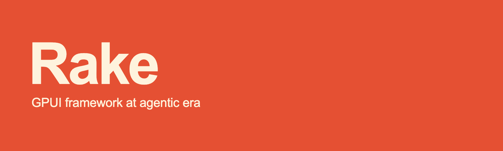

# Rake

Rake is a framework that provides an out-of-the-box experience with
[GPUI](https://github.com/zed-industries/zed/tree/main/crates/gpui) in the agentic era.
Build desktop and browser apps from one Rust codebase, with tools that let you and your
AI agents inspect and control the running app.

> **Alpha.** APIs can change between revisions. See [what's supported](docs/support.md).

## What you get

- **One app, two targets.** One application factory for native and WebAssembly, with
  direct GPUI access through `rake::gpui`.
- **App structure.** Typed routes, independent tabs and histories, native multi-window
  support, and save/discard/cancel guards.
- **Managed async work.** Route loaders, retries, and tasks owned by tabs or the app.
- **Shared services.** HTTP, storage, diagnostics, files, clipboard and preferences
  behind one `rake` dependency.
- **Agent tooling.** Commands with JSON schemas, JSON CLI output, element inspection and
  Chrome DevTools.
- **Development and shipping.** Watched builds, checkpointed reloads, packaging,
  signing and update controllers.
- **UI options.** The `view!` syntax on [GPUI Base](docs/gpui-kit.md), optional
  GPUI Kit components (native only), and [AppKit controls](crates/rake-native/README.md).

## Quick start

Rake needs Rust 1.98.0 and native development tools. Install the CLI
and create a desktop/browser app:

```sh
cargo install rake-app-cli --version 0.1.0-alpha.6 --locked
rake new hello-rake
cd hello-rake
rake dev
```

The generated app has two pages, a persistent layout, a theme and an agent-callable
command. For the browser, use `rake dev --target web` with a WebGPU-capable browser
and the matching `wasm-bindgen-cli` (the builder prints the install command).
The first dev run creates `Cargo.lock`; commit it. `rake new` pins Rake to the
version of the installed CLI.

UI uses `view!` (it's comptime). A complete Hello window looks like this:

```rust
use rake::gpui::{Context, Window, prelude::*};
use rake::prelude::*;

struct Hello;

impl Render for Hello {
    fn render(&mut self, _: &mut Window, _: &mut Context<Self>) -> impl IntoElement {
        rake::view! { 
          <main class="size-full p-6">
            <h1>"Hello, Rake!"</h1>
          </main> 
        }
    }
}

#[rake::app]
fn app() -> App {
    App::new("com.example.hello-rake")
        .root(|_, _, cx| cx.new(|_| Hello).into())
}
```

To add Rake to an existing crate, use `cargo add rake-app@0.1.0-alpha.5 --rename rake`
and then use the Hello entry above. `view!`, themes and style
presets are included by default; Kit and DevTools remain optional.

[Getting started](docs/getting-started.md) covers browser prerequisites, local
Rake development and agents. On macOS, check that `which rake` selects Cargo's CLI
rather than the system Ruby tool.

## Tiny examples

Short snippets for what comes after the Hello window. Plain GPUI elements also work
everywhere through `rake::gpui`.

### State and events

A view keeps its state in ordinary fields. Mount it the same way as the Hello window:

```rust
struct Counter {
    count: usize,
}

impl Render for Counter {
    fn render(&mut self, _: &mut Window, cx: &mut Context<Self>) -> impl IntoElement {
        rake::view! {
            <main class="size-full p-6 gap-4">
                <p>{format!("Count: {}", self.count)}</p>
                <button id="increment" on:click={cx.listener(|this, _, _, cx| {
                    this.count += 1;
                    cx.notify();
                })}>
                    Increment
                </button>
            </main>
        }
    }
}
```

### Async data

The loader belongs to the view: it redraws on completion and cancels with the view.

```rust
// When creating the view, with `root_with` providing `runtime`:
let text = runtime.load(cx, |load| async move {
    load.background_executor()
        .spawn(async { std::fs::read_to_string("welcome.txt") })
        .await
});

// In `render`:
let label = match self.text.state(cx) {
    LoadStatus::Ready(text) => text.clone(),
    LoadStatus::Failed(error) => error.to_string(),
    _ => "Loading…".into(),
};
```

### Typed routes

A destination with no registered page fails to compile:

```rust
#[derive(Clone, Route)]
enum Destination {
    #[route(id = "home", path = "/")]
    Home,
    #[route(id = "document", path = "/documents/{id}")]
    Document(u64),
}

App::new("com.example.documents")
    .routes(rake::routes! {
        Destination::Home => Home,
        Destination::Document(..) => DocumentPage,
    })
    .initial(Destination::Home)
```

`Home` and `DocumentPage` implement `Page<Destination>`. See [routing](docs/routing.md).

### Driving a running app from the CLI

An AI agent can use the same terminal commands as you. An app opts in with
`.control(rake::control::ControlConfig::FromEnvironment)`. `rake ctl` reads and controls
the app; point `RAKE_CONTROL_DIR` at the `control` directory of the session printed by
`rake dev`:

```sh
rake instances --json
rake ctl commands list --json
rake ctl commands run app.greet --args '{"name":"Rake"}' --json
rake ctl inspect tree --json
rake ctl logs list --json
```

`rake agent` works through Chrome DevTools Protocol (CDP), using the URL printed by
`rake dev --cdp`. It finds elements, sends real input and waits for the UI to update,
here on the counter above:

```sh
rake agent --url http://127.0.0.1:PORT/TOKEN '{"action":"snapshot"}'
rake agent --url http://127.0.0.1:PORT/TOKEN '{"action":"click","query":{"id":"increment"}}'
rake agent --url http://127.0.0.1:PORT/TOKEN '{"action":"waitFor","query":{"text":"Count: 1"}}'
rake agent --url http://127.0.0.1:PORT/TOKEN '{"action":"screenshot","path":"/tmp/app.png"}'
```

Screenshots are native-only and need the adapter started with `--capture`. See
[connecting an agent](docs/getting-started.md#connect-an-agent), [runtime control](docs/runtime-control.md)
and the [CDP agent client](docs/cdp-agents.md).

### Guarding quit

Standalone close, routed apps and update restarts all go through the same check:

```rust
App::new("com.example.editor")
    .quit_guard(|_| async { Err(rake::router::GuardReason("export is running".into())) })
```

See [guarded quit](docs/guarded-quit.md).

### Packaging

Describe the app in `Cargo.toml` and prepare its resources in `build.rs`:

```toml
[package.metadata.rake.bundle]
schema_version = 1
name = "My App"
identifier = "com.example.my-app"
icon = "assets/icon.svg"
resources = [{ from = "assets/help.txt", to = "help.txt" }]
```

```rust
// build.rs
fn main() {
    rake_build::build().expect("prepare desktop resources");
}
```

Check the prerequisites, preview the plan, then build. Desktop bundles default to DMG
on macOS, NSIS on Windows and AppImage on Linux:

```sh
rake doctor --distribution --package my-app --json
rake bundle --package my-app --plan --json
rake bundle --package my-app --json
rake bundle --target web --package my-app --base-path /my-app/ --routing path --json
```

See [desktop distribution](docs/distribution.md) and [packaging](docs/packaging.md).

### Updates

Updates are off by default. Enable them with an HTTPS root and your public keys:

```toml
[package.metadata.rake.bundle.updates]
enabled = true
channel = "stable"
base_url = "https://downloads.example.com/my-app"

[package.metadata.rake.bundle.updates.public_keys]
sparkle = "packaging/sparkle.pub"
velopack = "packaging/velopack.pub"
appimage = "packaging/appimage.pub"
```

```sh
rake update-key generate --private-key /secure/my-app-velopack.key --public-key packaging/velopack.pub
```

With the `updates` feature, a view binds to the shared controller. Restarting to
update runs your quit guards first:

```rust
// When creating the view, with `root_with` providing `runtime`:
let updates = runtime.bind_updates(cx);

// In `render`:
let can_check = self.updates.can_check(cx);
let can_restart = self.updates.can_restart(cx);

rake::view! {
    <div class="flex flex-row gap-3">
        <button disabled={!can_check}
            on:click={cx.listener(|this, _, _, cx| this.updates.check(cx))}>
            Check for updates
        </button>
        <button disabled={!can_restart}
            on:click={cx.listener(|this, _, _, cx| this.updates.restart(cx))}>
            Restart to update
        </button>
    </div>
}
```

### Publishing a release

Name where releases go and which targets each one must include:

```toml
[package.metadata.rake.bundle.release.publisher]
kind = "directory"
path = "release-site"
public_url = "https://downloads.example.com/my-app"

[package.metadata.rake.bundle.release.required]
aarch64-apple-darwin = ["zip", "dmg"]
x86_64-pc-windows-msvc = ["velopack"]
x86_64-unknown-linux-gnu = ["appimage", "deb", "rpm"]
```

The plan loads no signing credentials and publishes nothing. The release signs,
verifies and publishes, and a failure at any step prevents promotion:

```sh
rake release --plan --json
rake release --json
```

See [releasing native applications](docs/distribution-release.md).

## Try the examples

From a clone of this repository:

| Command | Shows |
| --- | --- |
| `cargo run -p rake-notes` | Fieldnotes, the [reference app](docs/notes.md): search, autosave, crash recovery |
| `cargo run -p rake-foundation` | App setup, HTTP and diagnostics |
| `cargo run -p rake-routing` | Tabs, histories, guards and managed work |
| `cargo run -p rake-view` | The `view!` syntax |
| `cargo run -p rake-desktop-example` | Pages, layouts, loading and native updates |
| `cargo run -p rake-files` | Files, clipboard and preferences |
| `cargo run -p rake-kit-example --features kit,devtools` | GPUI Kit in routed tabs (native) |
| `cargo run -p rake-app --example native --features native-components` | AppKit controls (macOS) |

## Documentation

Start at the [documentation index](docs/README.md).

## Contributing

See [CONTRIBUTING.md](CONTRIBUTING.md).

## License

Licensed under either the [MIT License](LICENSE-MIT) or the
[Apache License, Version 2.0](LICENSE-APACHE), at your option.


[Tray icons](docs/tray.md): multiple application-owned native items, typed commands,
platform appearance extensions and rich popups. Run `cargo run -p rake-tray-example`.
