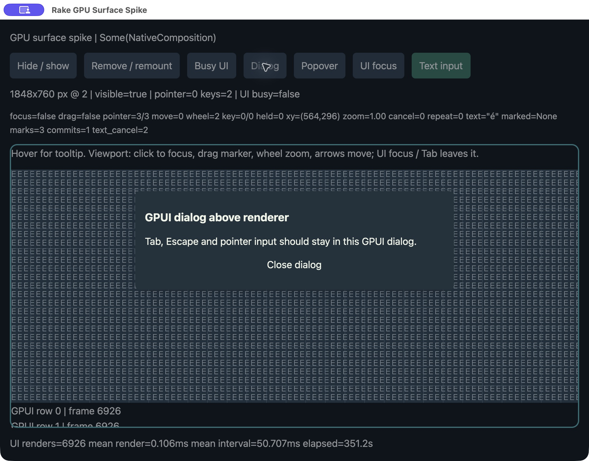

# Experimental desktop GPU surfaces

The `rake/gpu-surface` feature enables GPUI Fast composition on macOS, Linux
and Windows. Create a `GpuSurface` in a GPUI window, place its `element()`
in the layout, and pass its `target()` to the renderer. Use `on_change()`
to receive physical size, scale, visibility and window close. The renderer
owns its device, swapchain and frame loop. After configuring a swapchain,
call `commit_target(window)` on the GPUI thread to apply the attachment.

| Platform | `SurfaceTarget` |
| --- | --- |
| macOS | Retained `CAMetalLayer`. The existing `metal_layer()` accessor also works. |
| Linux | GPUI Fast's Wayland subsurface or X11 child window with its matching display handle. Release the renderer's surface before the GPUI window or host. |
| Windows | GPUI Fast's `IDCompositionVisual`. A compositor recovery sends another `on_change()` notification. Query `target()` again and reattach the swapchain if the visual changed. |

On Linux and Windows the reported extent follows the visible rectangle. On
macOS the layer retains the full layout extent and GPUI clips its container.

## macOS example

The demo attaches an independent wgpu 28 producer to the Metal layer. GPUI
composites overlays above the renderer.

Run on a logged-in macOS desktop with Metal.

```sh
cargo run -p rake-gpu-surface --release --features fast --locked
```

Click the viewport to focus it. Drag the marker, wheel to zoom or use the arrow
keys. **UI focus** and Tab return keys to the surrounding UI. **Text input** switches
the focused viewport to AppKit composition. On the U.S. layout, Option-E
followed by E shows a marked accent and then commits `é`. Focus loss and
opening an overlay discard pending composition. Press and hold Space with
**Text input** off to see native autorepeat in the `repeat` counter.

Use **Hide / show** and **Remove / remount** to exercise surface lifecycle.
**Busy UI** adds GPUI work while the producer continues rendering on its thread.
The optional `devtools` feature adds GPUI timing diagnostics. Pass
`-- --baseline` to start the same UI without the producer.

The original macOS spike verified pointer capture, wheel, keyboard, focus,
overlay blocking, remount, and AppKit marked text. A physical Space hold
forwarded 106 autorepeats with the viewport focused. The GPUI trace also showed
repeats with UI focus, a dialog or a popover active while producer counts
stayed fixed.



The release build against main at `7160bd2` showed the live renderer and
accepted a viewport click and Right-arrow input. Window capture became
unavailable during the follow-up, so the overlay and IME evidence above comes
from the original spike.

Clipping follows rectangular layout bounds. Rounded masks, CJK candidate
selection, and comparative performance remain open. The existing
`rake-native` elements use upstream GPUI types, so combining them with Fast
is outside this experiment.
